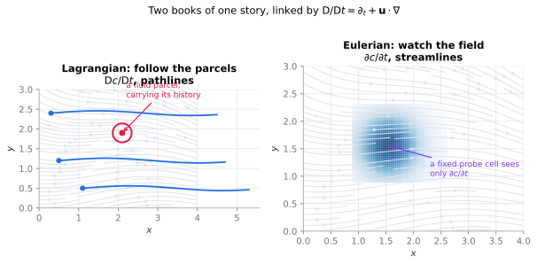

# The material derivative

> **One-line picture.** You can describe a river by drifting down it in a boat, or by standing
> on the bank watching the water pass. Both are complete; the material derivative is the
> translation service between them.
>
> **Prerequisites.** [balance laws & flux](01-balance-laws-and-flux.md) · **Leads to.**
> [advection](../02-bulk/01-advection.md)

## L1 · What it is, in words

Put a leaf in a stream. The leaf travels. Now stand on a bridge above the same stream with a
thermometer: the reading drops because *colder water arrived*, not because this water cooled.
Two different rates of change exist — the rate **of a thing** (what the leaf experiences) and
the rate **at a place** (what the instrument reads). The material derivative is the first,
expressed in terms of the second plus the motion.

## L2 · The mathematical object

$$\frac{\mathrm{D}c}{\mathrm{D}t}=\underbrace{\partial_t c}_{\text{local}}+\underbrace{\mathbf{u}\cdot\nabla c}_{\text{carried}}.$$

Derivation in one line: follow the parcel, so $c(\mathbf{x}(t),t)$ with $\dot{\mathbf{x}}=\mathbf{u}$
and the chain rule gives $\partial_t c+\dot{\mathbf{x}}\cdot\nabla c$. **The advection term is
not a new physical effect; it is the chain rule applied to motion.**

| Curve | Fixed | What it shows |
|---|---|---|
| pathline | which parcel | trajectory of one fluid element |
| streamline | which instant | tangent to $\mathbf{u}$ in a frozen snapshot |
| streakline | which source | where dye from one point has gone (what you photograph) |

They coincide only in steady flow; most confusion about "following the flow" is confusion
between these three.

Mass obeys the balance law with $c=\rho$, $\mathbf{J}=\rho\mathbf{u}$, $f=0$:

$$\partial_t\rho+\nabla\cdot(\rho\mathbf{u})=0\quad\Longleftrightarrow\quad
\frac{\mathrm{D}\rho}{\mathrm{D}t}+\rho\nabla\cdot\mathbf{u}=0 .$$

A parcel's density falls exactly as fast as the parcel expands, so $\nabla\cdot\mathbf{u}=0$
means *the material does not compress* — it is a statement about the substance, not about
speed. (Nozzle flow can be nearly incompressible at 500 m/s; sound in water is compressible
at millimetres per second.)

## L3 · What the mathematics guarantees

**Reynolds transport theorem.** For a volume moving with the material,

$$\frac{\mathrm{d}}{\mathrm{d}t}\int_{V(t)}c\,\mathrm{d}V=\int_{V(t)}\big[\partial_t c+\nabla\cdot(c\mathbf{u})\big]\mathrm{d}V,$$

which is why conservative and advective forms agree for smooth fields and **disagree at
shocks**, where the advective form is simply wrong — see
[conservation laws & shocks](../06-beyond/01-conservation-laws-and-shocks.md).

**Objectivity.** Constitutive laws must not depend on the observer's rotation. Written
naively, $\mathrm{D}\boldsymbol\tau/\mathrm{D}t$ is not objective; the corrections (Jaumann,
Oldroyd) are exactly the corotational terms in viscoelastic models —
[memory & viscoelastic transport](../06-beyond/04-memory-viscoelastic-and-hereditary.md).

**Circulation.** For inviscid barotropic flow with conservative body forces, Kelvin's theorem
makes circulation around a material loop constant: vorticity is carried, not created.

## L4 · Numerics, limits, frontiers

* **Eulerian** codes stand on the bank: face fluxes require
  [limiters](../07-numerics/04-limiters-tvd-and-weno.md) to keep fronts monotone.
* **Lagrangian** codes (SPH, vortex, PIC) ride the boat: advection is free of numerical
  diffusion, at the cost of particle disorder, remeshing and modelled collisions.
* **Semi-Lagrangian** schemes follow parcels only for the departure step —
  stable at CFL $>1$, but they leak mass unless made conservative, which is fatal for
  climate and reservoir models.
* **ALE** moves the mesh with the interface and keeps the bulk Eulerian: the standard tool
  for free surfaces and [moving boundaries](../06-beyond/09-free-boundaries-level-sets-and-phase-field.md).
* **Open.** Lagrangian data assimilation (updating particle clouds from Eulerian
  observations); objectivity-preserving learned closures.

## Words that collide

> **Advective vs conservative form:** $\mathbf{u}\cdot\nabla c$ and $\nabla\cdot(\mathbf{u}c)$
> differ by $c\nabla\cdot\mathbf{u}$ — identical for smooth or incompressible fields,
> catastrophic across shocks. **"Convective derivative"** in fluid mechanics means the whole
> $\mathrm{D}/\mathrm{D}t$; in heat transfer "convection" means diffusion *plus* advection.

## Checks

1. Steady flow ($\partial_t\mathbf{u}=0$): can a parcel still accelerate? *(Yes —
   $\mathbf{u}\cdot\nabla\mathbf{u}\neq 0$ in a nozzle.)*
2. Why is the conservative form preferred in codes that must resolve shocks? *(Jump
   conditions follow from it automatically.)*
3. Where do the corotational terms in Oldroyd-B come from? *(Enforcing frame invariance on a
   tensor.)*

## See also

[Balance laws & flux](01-balance-laws-and-flux.md) ·
[Constitutive relations](03-constitutive-relations.md) ·
[Advection](../02-bulk/01-advection.md) ·
[Mixing & chaotic advection](../02-bulk/07-mixing-and-chaotic-advection.md)
