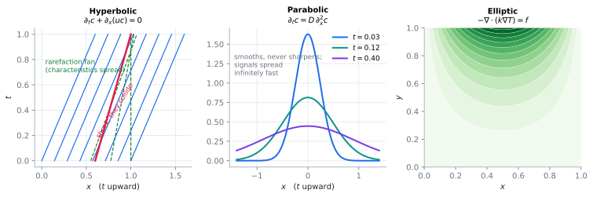

# PDE taxonomy & boundary conditions

> **One-line picture.** Ask which type your operator is (it decides the physics *and* the
> numerics), then ask what happens on the boundary (it decides whether a unique answer exists).
>
> **Prerequisites.** [balance laws & flux](01-balance-laws-and-flux.md) · **Leads to.**
> [discretisation](../07-numerics/01-discretization-consistency-stability-convergence.md),
> [conservation laws & shocks](../06-beyond/01-conservation-laws-and-shocks.md)

## L1 · Three temperaments

* **Elliptic** — *equilibrium*: flux in equals flux out everywhere at once; the domain feels the
  boundary instantly. Steady conduction, $-k\nabla^2T=f$.
* **Parabolic** — *spreading*: smooths and forgets initial detail. Blurring a photo *is*
  integrating a parabolic equation. Diffusion.
* **Hyperbolic** — *signal carrying*: finite-speed characteristics, shocks, no self-smoothing.
  Advection, waves, traffic.

Real models mix all three, and the winner is decided by dimensionless numbers —
[note 5](05-dimensionless-numbers.md).

## L2 · Order, type, characteristics

For $Au_{xx}+2Bu_{xy}+Cu_{yy}+\cdots=0$, the type is read from $\Delta=B^2-AC$:

| $\Delta$ | Type | Characteristics | Prototype | Behaviour |
|---|---|---|---|---|
| $<0$ | elliptic | none real | $\nabla^2u=f$ | smoothing, global influence |
| $=0$ | parabolic | one family | $\partial_tu=Du_{xx}$ | smooths while propagating |
| $>0$ | hyperbolic | two families | $\partial_tu+cu_x=0$ | finite speed, shocks |

Characteristics are curves $x'(t)=\lambda$ on which the PDE becomes an ODE, and they answer
**where data must be given**: hyperbolic — on a non-characteristic curve; parabolic — initial
data plus boundary data for all $t>0$; elliptic — boundary data only.

**Order** is a separate axis: it fixes how many boundary conditions are needed (fourth-order
plate equations want two per edge) and how wide a stencil must be (3 points for second order,
5 for fourth).

## L3 · Well-posedness and the BC catalogue

Hadamard: a solution **exists**, is **unique**, and depends **continuously** on the data.
Break the third and the problem is ill-posed — the backward heat equation is the canonical
example, and it is exactly why deblurring and inversion are hard
([inverse problems](../07-numerics/10-inverse-problems-and-data-assimilation.md)).

| Name | Form | Physics |
|---|---|---|
| Dirichlet | $c=c_b$ | wall held at fixed state |
| Neumann | $-\mathbf{J}\cdot\mathbf{n}=q_b$ | insulated wall, fixed heater |
| Robin | $-\mathbf{J}\cdot\mathbf{n}=h(c-c_\infty)$ | convective transfer, surface reaction |
| Cauchy | state **and** flux | wave initial data (over-determined if elliptic) |
| outflow / radiation | $\partial_tc+U\partial_nc=0$ | open domain (Danckwerts) |
| periodic | $c(0)=c(L)$ | circular topology, ring reactors |
| interface / jump | $\llbracket\mathbf{J}\cdot\mathbf{n}\rrbracket=0$ | material contact; state may jump (Henry) |
| free boundary | $s(t)$ unknown | melting, cracks, shorelines |

Three rules: **flux conditions are more physical than value conditions**; **never let an outflow
boundary be re-entered**; **at an interface, flux is always continuous and the state only if
you decide so.**

## L4 · Numerics and frontiers

* Type dictates the scheme: elliptic → sparse solve with
  [multigrid](../07-numerics/06-linear-solvers-and-preconditioning.md); parabolic →
  [implicit stepping](../07-numerics/02-cfl-stiffness-and-time-integration.md); hyperbolic →
  [limiters](../07-numerics/04-limiters-tvd-and-weno.md).
* **BCs are a leading source of bugs.** Diagnose by conservation: integrate the boundary flux
  and compare with the change of mass inside. A mismatch *is* a bug.
* **Artificial boundaries** must be indistinguishable from infinity: sponge layers,
  characteristic (non-reflecting) conditions, perfectly matched layers.
* **Frontiers.** Boundary theory for [fractional](../06-beyond/03-nonlocal-and-fractional-operators.md)
  and [nonlocal operators](../06-beyond/11-microcontinuum-and-generalized-continua.md), where
  the boundary is no longer a simple closed curve; learned boundary closures; well-posedness of
  tightly coupled multiphysics.

## Words that collide

> **Order** (derivatives) vs **order** (convergence). **Robin** combines state and flux;
> **Cauchy** prescribes both independently. **Type** is local and can *change* where a
> coefficient changes sign (transonic flow) — codes must cope.

## Checks

1. Type of $\partial_tu=D\partial_x^2u$ with $D<0$? *(Ill-posed; this is backward-in-time heat flow.)*
2. You must inject a fixed mass rate through a wall — which family, and why not the other?
   *(Neumann, since a Dirichlet value would make the injected rate grid-dependent.)*

## See also

[Discretisation](../07-numerics/01-discretization-consistency-stability-convergence.md) ·
[Conservation laws & shocks](../06-beyond/01-conservation-laws-and-shocks.md) ·
[Words that collide: flux, source, sink](../09-polysemy/04-absorption-and-sink-lingo.md)
