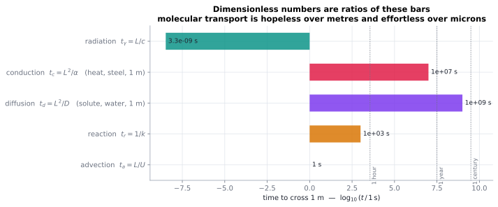

# Dimensionless numbers

> **One-line picture.** Every dimensionless group is a race between two processes. Who wins
> decides the physics, the grid, and which term you are allowed to throw away.
>
> **Prerequisites.** [balance laws & flux](01-balance-laws-and-flux.md) · **Leads to.** every
> regime discussion in the atlas, [boundary layers](../02-bulk/04-boundary-layers.md)

## L1 · What it is, in words

Ask "how long does heat take to cross this?" and answer three ways: carried ($L/U$), diffused
($L^2/D$), reacted ($1/k$). Any ratio of two answers is a dimensionless number. Péclet $10^6$
means advection beats diffusion a million to one, so you may neglect diffusion — until the
sharp front it creates matters.

**They are the only things that transfer between scales.** A 1:10 river model gets sediment
transport wrong unless the Péclet number matches; a 1 mm cooling simulation predicts a 1 mm
chip and nothing else.

## L2 · How to form them

Nothing to guess: make the equation dimensionless. With $c=c^*C$, $\mathbf{x}=L\mathbf{x}^*$,
$t=(L/U)t^*$,

$$\partial_{t^*}C+\mathbf{u}^*\!\cdot\!\nabla^*C=\frac{1}{\mathrm{Pe}}\nabla^{*2}C+\mathrm{Da}\,R^*(C),
\qquad \mathrm{Pe}=\frac{UL}{D},\quad \mathrm{Da}=\frac{kL^2}{D}.$$

| Number | Definition | Race | Small | Large |
|---|---|---|---|---|
| Péclet $\mathrm{Pe}$ | $UL/D$ | advection / diffusion | smooth, diffusion-limited | boundary layers, sharp fronts |
| Reynolds $\mathrm{Re}$ | $UL/\nu$ | inertia / viscosity | laminar, reversible | turbulence |
| Rayleigh $\mathrm{Ra}$ | $g\beta\Delta TL^3/\nu\alpha$ | buoyancy / dissipation | conduction only | vigorous convection |
| Damköhler $\mathrm{Da}$ | $kL^2/D$ or $kL/U$ | transport / reaction | transport-limited | thin reaction sheets |
| Nusselt $\mathrm{Nu}$ | $hL/k$ | actual / conductive heat | pure conduction | strong convection |
| Sherwood $\mathrm{Sh}$ | $h_mL/D$ | mass analogue of $\mathrm{Nu}$ | pure diffusion | strong advection |
| Prandtl $\mathrm{Pr}$ | $\nu/\alpha$ | momentum / heat diffusion | liquid metals | oils |
| Schmidt $\mathrm{Sc}$ | $\nu/D$ | momentum / mass diffusion | gases | liquids |
| Knudsen $\mathrm{Kn}$ | $\lambda/L$ | mean free path / size | continuum | rarefied, ballistic |
| Mach $\mathrm{Ma}$ | $U/c_s$ | flow / sound | incompressible | shocks |
| Marangoni $\mathrm{Ma}$ | $(\partial_T\sigma)\Delta TL/\mu\alpha$ | surface tension / viscosity | bulk-driven | surface-driven |
| Weissenberg $\mathrm{Wi}$ | $\lambda\dot\gamma$ | polymer memory / flow | Newtonian | elastic |
| Stefan $\mathrm{St}$ | $c_p\Delta T/\Delta h$ | sensible / latent heat | — | phase change dominates |
| Biot $\mathrm{Bi}$ | $hL/k$ | external / internal resistance | isothermal body | strong internal gradients |

## L3 · Why they are more than bookkeeping

* **They license asymptotics.** $\mathrm{Pe}\to\infty$ produces boundary layers and inner/outer
  expansions; $\mathrm{Kn}\to0$ produces the Chapman–Enskog expansion of kinetic theory
  ([Boltzmann](../05-kinetic/01-boltzmann-equation.md)).
* **They change the mathematics, not just the numbers.** Past a critical $\mathrm{Pe}$ at grid
  scale, the steady advection–diffusion problem loses admissible smooth solutions;
  [nonlinear diffusion](../06-beyond/06-nonlinear-diffusion-and-porous-medium.md) can lose
  uniqueness. Regime decides theory.
* **They reveal similarity.** When no intrinsic length or time exists, solutions collapse onto
  one profile: $\sqrt{Dt}$, $\sqrt{\alpha t}$ for a Stefan interface, third-power scaling laws
  for convection. Dimensionless analysis is how you *find* the collapse.

## L4 · Regimes decide algorithms

| Regime | Numerical consequence |
|---|---|
| diffusion-dominated ($\mathrm{Pe}\lesssim1$) | implicit stepping, centred fluxes |
| advection-dominated ($\mathrm{Pe}\gg1$) | upwind/TVD or spectral; watch numerical diffusion |
| reaction-dominated ($\mathrm{Da}\gg1$) | implicit reactions, operator splitting, front tracking |
| rarefied ($\mathrm{Kn}\gtrsim0.1$) | kinetic solvers: DSMC, lattice Boltzmann, moment closures |
| chaotic ($\mathrm{Re}\gg10^3$) | LES/DNS; resolution follows the Kolmogorov scale |

> **Trap.** A large number can still be irrelevant: a boundary layer may carry almost none of
> the total flux yet dominate the near-wall solution, and a flame sheet liberates nearly all
> the heat inside a millimetre. Regime maps locate the action — *resolution must follow the
> action, not the domain.*

## Checks

1. 1 cm pipe, 1 cm/s water, dye with $D=10^{-9}$ m²/s: $\mathrm{Pe}$? *($10^4$: advection wins.
   The same dye across a 1 µm membrane: $\mathrm{Pe}\sim10^{-5}$, pure diffusion.)*
2. Why does a flame get thinner as pressure rises? *(Reaction and diffusion scale differently
   with density, so the effective $\mathrm{Da}$ grows and the sheet thins.)*

## See also

[Dimensionless number cards](../10-appendix/02-dimensionless-number-cards.md) ·
[Boundary layers](../02-bulk/04-boundary-layers.md) ·
[Key derivations](../10-appendix/04-key-derivations.md)
