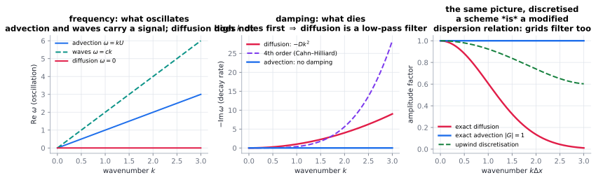

# The spectral view: Fourier, Green functions, propagators

> **One-line picture.** Decompose the state into sine waves; linear transport acts on each wave
> independently — shifting its phase, shrinking its amplitude, or both. Everything else is
> superposition.
>
> **Prerequisites.** [balance laws & flux](01-balance-laws-and-flux.md) · **Leads to.**
> [numerical diffusion & dispersion](../07-numerics/03-numerical-diffusion-and-dispersion-error.md)

## L1 · Waves are the natural alphabet

Linear equations never mix wavelengths: each evolves alone. So you only need to know what an
operator does to a single $e^{i(kx-\omega t)}$ — *does the phase move?* (does it travel?) and
*does the amplitude decay?* (does it blur?). Diffusion is pure amplitude loss, fastest at large
$k$, which is why blurring wipes out detail and keeps outlines. Advection is pure phase motion,
identical at every wavelength, which is why a carried cloud keeps its shape.

## L2 · The dictionary

Substituting $e^{i(kx-\omega t)}$ replaces $\partial_t\to-i\omega$, $\nabla\to ik$:

| Equation | Dispersion relation | Reading |
|---|---|---|
| $\partial_tc+U\partial_xc=0$ | $\omega=Uk$ | travel at $U$; shape frozen |
| $\partial_tc=D\nabla^2c$ | $\omega=-iDk^2$ | decay $e^{-Dk^2t}$; short waves die first |
| $\partial_t^2u=c^2\nabla^2u$ | $\omega=\pm ck$ | two directions, no damping |
| Cattaneo / telegraph | $\omega^2+i\omega/\tau=c^2k^2$ | waves that damp into diffusion |
| Cahn–Hilliard | $\omega=-iMk^2(\kappa k^2-f'')$ | *growth* at intermediate $k$: patterns |
| advection–diffusion | $\omega=Uk-iDk^2$ | both effects at once, still independent per $k$ |

The **symbol** of an operator is what you get by replacing derivatives: $\mathcal{L}(ik)$. A
point source's response is the **Green function**, and the solution operator is convolution
with it — transport *is* the promotion of an initial bump into a spread profile.

## L3 · What the mathematics guarantees

* **Semigroup:** $G(t_1+t_2)=G(t_1)*G(t_2)$. Memorylessness makes the Gaussian the unique
  convolution kernel for diffusion — the central limit theorem in operator clothing.
* **Reciprocity:** with symmetric coefficients, $G(\mathbf{x},\mathbf{y})=G(\mathbf{y},\mathbf{x})$
  — Onsager symmetry, optical reciprocity and elastic Green reciprocity are one idea.
* **Positivity:** diffusion kernels are positive and mass-preserving, so solutions inherit
  positivity — the basis of the maximum principle. Advection kernels are shifts and preserve
  sharpness, which is precisely why *no* linear regularisation can fix a shock.
* **Spectral gap:** the slowest mode sets the relaxation time. On a domain of size $L$,
  diffusion relaxes on $L^2/(\pi^2D)$.
* **Irreversibility:** $\omega=-iDk^2$ cannot be run backwards without infinite amplification —
  the Fourier face of ill-posedness.

## L4 · Why this view runs numerics

* **Methods.** Spectral/pseudo-spectral schemes give exponential convergence for smooth data;
  convolution quadrature and FFT solvers exist because these operators *are* convolutions —
  that is how [fractional and nonlocal](../06-beyond/03-nonlocal-and-fractional-operators.md)
  equations are solved quickly.
* **Errors.** A scheme has its own $\omega_{\rm num}(k)$; damping error $=$ numerical diffusion,
  phase error $=$ numerical dispersion —
  [numerics note 3](../07-numerics/03-numerical-diffusion-and-dispersion-error.md).
* **Aliasing.** Nonlinear terms fold unresolved wavenumbers back into resolved ones; dealiasing
  and skew-symmetric forms exist to prevent it.
* **Tools.** Green functions appear as preconditioners, boundary integral kernels and adjoint
  operators for [inverse problems](../07-numerics/10-inverse-problems-and-data-assimilation.md).
* **Frontiers.** Learning solution operators directly
  ([operator learning](../07-numerics/11-machine-learning-and-operator-learning.md)); spectral
  theory of non-normal operators (transition to turbulence).

## Words that collide

> **Dispersion relation** (frequency vs wavenumber) is unrelated to porous-media *dispersion*
> ([words that collide #1](../09-polysemy/01-dispersion.md)). **Kernel** here is an integral
> kernel, not a machine-learning kernel. **Spectral** may mean spectral *method*, spectral
> *density*, or operator spectrum.

## Checks

1. Why does blurring destroy fine detail first? *($e^{-Dk^2t}$ decays fastest at large $k$.)*
2. A scheme with $|G(k)|<1$ only at large $k$: how does it behave? *(Like diffusion — it is
   committing numerical diffusion.)*
3. What makes the diffusion kernel Gaussian? *(Semigroup plus finite variance — the CLT.)*

## See also

[Random walks & Langevin](08-random-walks-langevin-response.md) ·
[Entropy & variational structure](07-entropy-and-variational-structure.md) ·
[Numerical diffusion & dispersion](../07-numerics/03-numerical-diffusion-and-dispersion-error.md)
