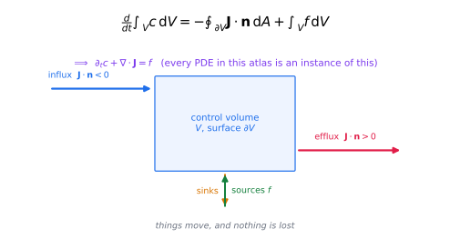

# Foundations: the grammar of transport

Everything downstream in this atlas is written in a small vocabulary. Nine notes build it,
in dependency order. If you have never seen a PDE, start at 1 and walk down; if you have,
use the table as a checklist of the language.

| # | Note | The one thing it gives you |
|---|---|---|
| 1 | [Balance laws & flux](01-balance-laws-and-flux.md) | why *every* transport equation is a divergence plus a source — and why the conservative form is non-negotiable |
| 2 | [The material derivative](02-material-derivative.md) | the dictionary between following a parcel and watching a field; where advection comes from |
| 3 | [Constitutive relations](03-constitutive-relations.md) | the closure step: Fick, Fourier, Darcy, Ohm, Newton — and the entropy constraint behind them |
| 4 | [PDE taxonomy & boundary conditions](04-pde-taxonomy-and-boundary-conditions.md) | elliptic / parabolic / hyperbolic, characteristics, well-posedness, and the BC catalogue |
| 5 | [Dimensionless numbers](05-dimensionless-numbers.md) | the ratios that decide which term wins — Pe, Re, Ra, Da, Kn, Nu … |
| 6 | [The spectral view](06-spectral-and-green-function-view.md) | one Fourier transform turns transport into arithmetic; Green functions as propagators |
| 7 | [Entropy & variational structure](07-entropy-and-variational-structure.md) | why transport equations are stable: Lyapunov functionals, maximum principles, gradient flows |
| 8 | [Random walks, Langevin & response](08-random-walks-langevin-response.md) | the microscopic origin of diffusion, the FDT, and why fluctuation and dissipation are one thing |
| 9 | [Linear response & memory](09-linear-response-and-memory.md) | what happens when the past matters: Green–Kubo, Mori–Zwanzig, and the origin of all "effective" models |

## Three ideas to carry everywhere

1. **Conservation is geometry.** Fluxes are vectors; the divergence theorem converts
   "what crosses the boundary" into "what accumulates inside". Nothing else in the subject
   is as reliable as this.
2. **Every closure is a bet.** The balance law is exact; the constitutive law is a model.
   The interesting questions are always about the validity range of the bet — and the
   dimensionless numbers in note 5 are how you check it.
3. **Transport is smoothing, translating, or sharpening.** Parabolic operators smooth
   (diffusion), hyperbolic operators translate or steepen into shocks (advection), and
   source terms amplify or kill (reactions). Recognise which one you are looking at and
   half the analysis is done.

> **Where to jump first.** If you only read two notes in this atlas, read
> [balance laws & flux](01-balance-laws-and-flux.md) and
> [dimensionless numbers](05-dimensionless-numbers.md). They are the two that transfer
> directly to almost any new problem in any field.

## Going further than second order

The nine notes above cover the classical core. Three more take the same language to **any order, any
dimension and any geometry** — which is what makes the classification claim general rather than a
statement about second-order equations in two variables:

| # | Note | The one thing it gives you |
|---|---|---|
| 10 | [General PDE classification](10-general-pde-classification.md) | the principal symbol; elliptic/hyperbolic/parabolic/dispersive *for any order, any $d$, and for systems*; symmetric hyperbolic, Petrovsky, weakly hyperbolic, constrained systems |
| 11 | [Higher order & dispersive](11-higher-order-and-dispersive.md) | parity and sign rules for third-, fourth- and higher-order operators; instability bands; Cahn–Hilliard, Kuramoto–Sivashinsky, thin films, plate equations |
| 12 | [Dimensions, geometry & manifolds](12-dimensions-geometry-and-manifolds.md) | how $d$ changes Green functions, recurrence and critical dimensions; anisotropic scaling; Laplace–Beltrami on curved spaces; fractals and spectral dimension |

> **Read them in that order.** 10 gives the general classification, 11 shows what changes with order, 12
> shows what changes with dimension and geometry. Together they close the gap that the classical
> two-variable table leaves open — and they are the prerequisites for the
> [universality part](../11-universality/index.md), where the same structures are recognised in fields that
> are not physics at all.

