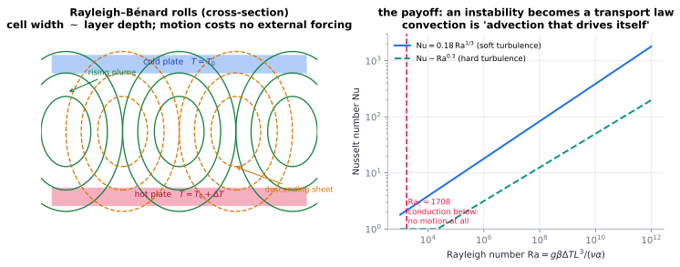

# Convection & buoyancy

> **One-line picture.** Convection is advection that drives itself: the transported quantity
> changes the density or the surface tension, the change moves the fluid, and the motion
> transports the quantity.
>
> **Prerequisites.** [advection](01-advection.md),
> [dimensionless numbers](../01-foundations/05-dimensionless-numbers.md) · **Leads to.**
> [turbulence](05-turbulence-and-eddy-diffusivity.md),
> [geoscience & climate](../08-bridges/04-geoscience-and-climate.md)

## L1 · Four ways to make a fluid move by transporting something

* **Natural (free)** — density differences created by the transported quantity. Warm air rises;
  water near $4^\circ$C has $\beta\approx0$, which is why lakes freeze from the top.
* **Forced** — an external agent (pump, fan, wind) drives flow past a surface. The velocity
  field is known, so the transport problem is linear advection–diffusion.
* **Mixed** — both matter; the ratio is $\mathrm{Ri}=\mathrm{Gr}/\mathrm{Re}^2$.
* **Marangoni** — a surface-tension gradient pulls fluid along an interface, from low $\sigma$ to
  high $\sigma$. It dominates wherever interfaces are present and gravity is weak: drying
  coffee drops, welding pools, thin films, microgravity processing.

## L2 · The equations.

Boussinesq approximation (density variations matter only in the buoyancy term):

$$\rho_0(\partial_t\mathbf{u}+\mathbf{u}\cdot\nabla\mathbf{u})
=-\nabla p+\mu\nabla^2\mathbf{u}+\rho_0\beta(T-T_0)\mathbf{g},\qquad
\partial_tT+\mathbf{u}\cdot\nabla T=\alpha\nabla^2T,$$

with $\beta=-(1/\rho)\partial\rho/\partial T$. Marangoni convection replaces buoyancy by an
interfacial stress balance $\mu\,\partial_nu_{\rm t}=\sigma_T\,\partial_{\rm t}T+\sigma_c\,\partial_{\rm t}c$.

**The instability.** Perturb a quiescent conducting layer. Buoyancy amplifies on
$\sqrt{L/(g\beta\Delta T)}$ while viscosity and conduction damp on $L^2/\nu$ and $L^2/\alpha$.
Their ratio is the Rayleigh number, and the layer destabilises at $\mathrm{Ra}_c\approx1708$
(no-slip, rigid–rigid) — a *threshold*, not a gradual change.

## L3 · What the mathematics guarantees

* **Onset is a linear eigenvalue problem.** Below $\mathrm{Ra}_c$ the conduction state is the
  unique attractor; above it a bifurcation selects a wavelength $k_c\sim1/L$. The pattern scale
  comes from the *linear* problem, not the nonlinear dynamics — the same lesson as in
  [Turing patterns](../04-interaction/04-reaction-diffusion-and-turing.md).
* **Above onset, transport becomes a power law.** $\mathrm{Nu}\sim\mathrm{Ra}^{1/3}$ classically,
  $\sim\mathrm{Ra}^{0.30}$ in hard turbulence (with debated logarithmic corrections). These
  exponents are derived from boundary-layer/shear-layer balances, not fitted blindly.
* **Linear $\neq$ nonlinear stability.** The linear threshold does not guarantee that the
  bifurcated state is stable; energy methods give a lower *guaranteed* threshold. The gap
  between them is a standard caution.
* **Rotation and stratification change the physics**: Coriolis and buoyancy frequencies add
  $\mathrm{Ro}$, $\mathrm{Ta}$ and stratification parameters, producing Taylor–Proudman columns,
  internal waves and double-diffusive staircases. **Double diffusion** can be unstable even when
  the net density profile is stable, because heat and salt diffuse at different rates.

## L4 · Numerics, limits, frontiers

* **The coupling is stiff.** Momentum and energy must be advanced together; segregated schemes
  can diverge at strong coupling, and monolithic solves need coupled preconditioners
  ([coupling](../07-numerics/05-operator-splitting-and-multiphysics-coupling.md)).
* **Incompressibility** makes pressure a Lagrange multiplier solved by a Poisson problem each
  step ([vorticity & pressure](03-incompressible-flow-vorticity-and-pressure.md)).
* **Rayleigh–Bénard is a standard benchmark**: onset threshold, $\mathrm{Nu}(\mathrm{Ra})$ curves
  and pattern selection are used to verify codes
  ([V&V](../07-numerics/12-verification-validation-and-benchmarks.md)).
* **Interfacial convection** needs resolved, temperature-dependent surface tension and a
  deformable interface: [level sets or phase fields](../06-beyond/09-free-boundaries-level-sets-and-phase-field.md).
* **Frontiers.** Reactive porous-media convection, magnetoconvection and dynamos, and the extreme
  regime $\mathrm{Ra}\sim10^{15}$ (Sun, Earth's core) where neither experiment nor DNS is
  possible and scaling theory is the only predictor.

## Checks

1. Water at $4^\circ$C has $\beta=0$: is it convecting? *(No — buoyancy vanishes, which is why
   deep lake water sits at $4^\circ$C.)*
2. Why does $\mathrm{Ma}\sim L^2$ while $\mathrm{Ra}\sim L^3$? *(Surface effects are interfacial,
   buoyancy is volumetric — hence Marangoni wins in small systems, buoyancy in large ones.)*
3. Heated vertical plate in air: which numbers set the heat transfer? *($\mathrm{Ra}$, $\mathrm{Pr}$;
   laminar correlation $\mathrm{Nu}\sim\mathrm{Ra}^{1/4}$.)*

## See also

[Advection](01-advection.md) ·
[Turbulence & eddy diffusivity](05-turbulence-and-eddy-diffusivity.md) ·
[Boundary layers](04-boundary-layers.md) ·
[Geoscience & climate](../08-bridges/04-geoscience-and-climate.md)
