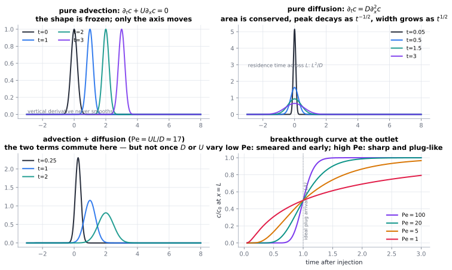

# Bulk fluid transport

This category is about the **flow itself**: how a velocity field carries things, how it is
generated, where it concentrates, and how it fails to be smooth.

| # | Note | The one thing it gives you |
|---|---|---|
| 1 | [Advection](01-advection.md) | the first-order term, characteristics, and the discretisation problem that never goes away |
| 2 | [Convection & buoyancy](02-convection-and-buoyancy.md) | advection that drives itself; Rayleigh–Bénard; $\mathrm{Nu}\sim\mathrm{Ra}^{1/3}$ |
| 3 | [Incompressible flow, vorticity & pressure](03-incompressible-flow-vorticity-and-pressure.md) | pressure as a constraint; vorticity transport and stretching |
| 4 | [Boundary layers](04-boundary-layers.md) | where the transport action is; similarity and separation |
| 5 | [Turbulence & eddy diffusivity](05-turbulence-and-eddy-diffusivity.md) | enhanced transport, the closure problem, and resolution limits |
| 6 | [Shear dispersion (Taylor–Aris)](06-shear-dispersion-taylor-aris.md) | how a velocity gradient becomes an enormous effective diffusion |
| 7 | [Mixing & chaotic advection](07-mixing-and-chaotic-advection.md) | stretch, fold, and diff: mixing without randomness |
| 8 | [Porous media & Darcy](08-porous-media-and-darcy.md) | averaging the pores away; permeability, dispersion, upscaling |
| 9 | [Non-Newtonian rheology](09-non-newtonian-rheology.md) | when the constitutive law carries memory or a threshold |

## How these notes fit together

Read **[advection](01-advection.md)** first: it is the term that appears in every other note here,
and the term that exposes numerical schemes. Then choose a direction:

* **Rising heat and self-driven flow** → [convection](02-convection-and-buoyancy.md) → [turbulence](05-turbulence-and-eddy-diffusivity.md).
* **Walls and surfaces** → [boundary layers](04-boundary-layers.md) → [heat–mass–momentum analogy](../08-bridges/01-analogy-and-circuit-models.md).
* **Spreading and mixing** → [shear dispersion](06-shear-dispersion-taylor-aris.md) → [mixing](07-mixing-and-chaotic-advection.md).
* **Subsurface flow** → [Darcy](08-porous-media-and-darcy.md) → [wells & breakthrough](../04-interaction/12-wells-injection-efflux-and-breakthrough.md) → [subsidence](../04-interaction/13-subsidence-and-poroelasticity.md).
* **Complex materials** → [non-Newtonian rheology](09-non-newtonian-rheology.md) → [memory & viscoelastic transport](../06-beyond/04-memory-viscoelastic-and-hereditary.md).

> **Recurring lesson of this category.** The velocity field decides *where* transport happens, and
> it is almost always *not* uniform. Multi-scale structure — boundary layers, pores, eddies,
> streamlines — is the rule, which is why everything here ends in an averaging or upscaling step.
