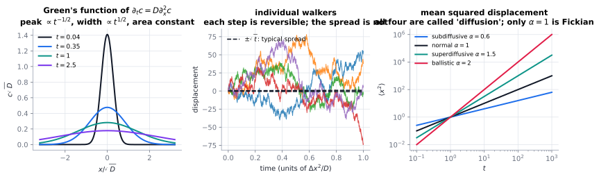

# Diffusion (Fick)

> **One-line picture.** Random molecular motion evens out concentrations, producing a flux
> proportional to the gradient — and a very specific, very slow kind of spreading.
>
> **Prerequisites.** [constitutive relations](../01-foundations/03-constitutive-relations.md) ·
> **Leads to.** [Brownian motion](02-brownian-motion-and-einstein-relations.md),
> [conduction](03-conduction.md), [anomalous diffusion](08-anomalous-diffusion.md)

## L1 · What it is

Put sugar in a still cup of tea and wait. Nothing stirs, yet the sugar spreads: molecules are
jostled billions of times a second, and although no molecule is *directed* anywhere, more leave the
dense region than enter it. The net effect is a patient flow from dense to dilute.

The patience is the point. Molecular diffusion moves matter over microns in milliseconds and over
metres in years — which is why biology and engineering deploy advection, convection or active
transport whenever something must move quickly
([battle of timescales](../01-foundations/05-dimensionless-numbers.md)).

## L2 · Fick's two laws

$$\mathbf{J}=-D\nabla c \ \ \text{(first)},\qquad \partial_tc=\nabla\cdot(D\nabla c)\ \ \text{(second)} .$$

For a point release in 1-D the solution is the Gaussian kernel
$c=\frac{M}{\sqrt{4\pi Dt}}e^{-x^2/(4Dt)}$, which encodes the whole personality of diffusion:

| Feature | Scaling | Consequence |
|---|---|---|
| width | $\sqrt{4Dt}$ | spreading slows: diffusive, not ballistic |
| peak height | $\propto t^{-1/2}$ | a pulse fades while conserving mass |
| penetration depth | $L\sim\sqrt{Dt}$ | the ubiquitous square-root law |
| time to cross $L$ | $t\sim L^2/D$ | 4$\times$ the distance costs 4$\times$ the time |
| MSD | $\langle x^2\rangle=2Dt$ | the definition of normal diffusion |

Anisotropy replaces $D$ by a symmetric positive-definite tensor, and tortuosity reduces it in
porous media, $D_{\rm eff}=D\theta/\tau$.

## L3 · What the mathematics guarantees

* **Maximum principle.** Solutions lie between the extremes of the data — no overshoots, ever. This
  is the basis of positivity in every transport solver.
* **Infinite propagation speed.** The Gaussian is nonzero everywhere for any $t>0$; information
  spreads infinitely fast, if faintly. This is the flaw that motivates
  [Cattaneo's hyperbolic heat equation](../06-beyond/04-memory-viscoelastic-and-hereditary.md).
* **Irreversibility.** High wavenumbers decay as $e^{-Dk^2t}$
  ([spectral view](../01-foundations/06-spectral-and-green-function-view.md)), the backward problem
  is ill-posed, and entropy grows ([variational structure](../01-foundations/07-entropy-and-variational-structure.md)).
* **Degeneracy changes the class.** If $D(c)\to0$ as $c\to0$, diffusion still holds but propagation
  speed becomes *finite* and free boundaries appear —
  [porous-medium equation](../06-beyond/06-nonlinear-diffusion-and-porous-medium.md).
* **It is a metric phenomenon.** Heat flow is steepest descent of entropy in the Wasserstein metric
  ([optimal transport](../06-beyond/10-optimal-transport-and-gradient-flows.md)).

## L4 · Numerics

* **Stiffness.** Explicit schemes need $\Delta t\le\Delta x^2/(2D)$: halving the grid quadruples the
  step count. Implicit schemes remove the limit at the cost of an elliptic solve per step
  ([time integration](../07-numerics/02-cfl-stiffness-and-time-integration.md)).
* **Positivity.** Centred advection plus diffusion produces undershoots (negative concentrations),
  which wreck reaction terms; use monotone or
  [flux-limited schemes](../07-numerics/04-limiters-tvd-and-weno.md).
* **Varying coefficients** must be discretised conservatively, with harmonic-type face averaging, or
  a spurious source appears at material interfaces
  ([structure-preserving schemes](../07-numerics/13-structure-preserving-discretizations.md)).
* **Benchmarks**: the Gaussian itself (via manufactured solutions), interface problems with jumps in
  $D$, and the Stefan problem for the degenerate case
  ([V&V](../07-numerics/12-verification-validation-and-benchmarks.md)).

## Checks

1. Glucose ($D\approx7\times10^{-10}$ m²/s) across 1 mm, then 1 m? *(≈24 minutes; ≈45 years.)*
2. Why does the peak decay while the area is constant? *(Conservation fixes area; spreading forces
   height down.)*
3. When is Fick's law invalid even though diffusion is the mechanism? *(When the mean free path
   approaches the device size — [Knudsen transport](05-knudsen-and-rarefied-transport.md).)*

## See also

[Brownian motion & Einstein relations](02-brownian-motion-and-einstein-relations.md) ·
[Conduction](03-conduction.md) ·
[Anomalous diffusion](08-anomalous-diffusion.md) ·
[Words that collide: diffusion & conduction](../09-polysemy/03-diffusion-and-conduction.md)
