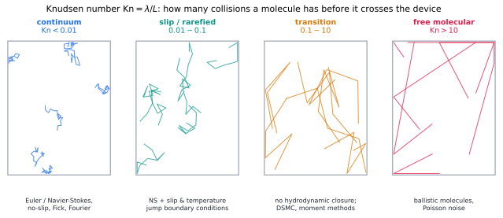

# Knudsen & rarefied transport

> **One-line picture.** Continuum laws assume molecules collide with each other far more often
> than with the walls. Shrink the device (or thin the gas) and that assumption dies — transport
> becomes ballistic, and slip replaces no-slip.
>
> **Prerequisites.** [diffusion coefficients](04-diffusion-coefficients.md) ·
> **Leads to.** [Boltzmann equation](../05-kinetic/01-boltzmann-equation.md),
> [lattice-Boltzmann & particles](../05-kinetic/06-lattice-boltzmann-and-particle-kinetics.md)

## L1 · The number that decides everything

$$\mathrm{Kn}=\frac{\lambda}{L}=\frac{\text{mean free path}}{\text{device size}} .$$

| Range | Regime | What you may use |
|---|---|---|
| $\mathrm{Kn}<0.01$ | continuum | Navier–Stokes + Fick/Fourier/Fourier, no-slip |
| $0.01-0.1$ | slip flow | NS with velocity-slip and temperature-jump conditions |
| $0.1-10$ | transition | no hydrodynamic closure: DSMC, moment methods, LBM |
| $>10$ | free molecular | ballistic molecules; direct wall-to-wall transport |

Everyday examples that sit in the awkward middle: micro-electromechanical sensors, vacuum gauges,
aerosols, hypersonic re-entry, shale-gas pores (nanometres at reservoir pressures), and the gas in
insulating aerogels.

## L2 · What replaces the constitutive laws

* **Velocity slip:** $u_{\rm wall}=\sigma_\lambda\lambda\,\partial_nu|_{\rm wall}$, with
  $\sigma_\lambda\approx1$. The no-slip condition is a large-$\mathrm{Kn}$ casualty, and slip adds
  an apparent reduction in drag and an increase in flow rate (apparent permeability in tight
  porous media — the Klinkenberg effect).
* **Temperature jump:** a discontinuity proportional to $\mathrm{Kn}$ appears between wall and gas,
  modifying heat transfer at micro scales.
* **Knudsen diffusion** in a pore: molecules hit walls more often than each other, so the flux is
  set by wall collisions rather than by molecule–molecule scattering:
  $D_K=\frac{2r_p}{3}\sqrt{8RT/\pi M}$, which is *independent of pressure* and important in
  catalysis and shale gas.
* **Combined regimes** use the Bosanquet formula $1/D=1/D_{\rm mol}+1/D_K$; the total conductance
  behaves like two resistors in series.

## L3 · What the mathematics guarantees

* **The continuum limit is a theorem, not an assumption.** Chapman–Enskog expansion of the
  [Boltzmann equation](../05-kinetic/01-boltzmann-equation.md) in $\mathrm{Kn}$ recovers
  Navier–Stokes at $O(\mathrm{Kn})$ and the Fourier/Fick laws with explicitly computable
  coefficients. Corrections at $O(\mathrm{Kn}^2)$ are the Burnett and super-Burnett terms, and
  they are famously unstable and non-hyperbolic — a warning that higher-order continuum closures
  are not automatically improvements.
* **Memory appears.** Relaxation-time (BGK) treatments give first-order-in-time corrections that
  augment the flux, i.e. a
  [Cattaneo-type hyperbolic heat equation](../06-beyond/04-memory-viscoelastic-and-hereditary.md) with
  finite propagation speed; the kinetic origin of finite-speed diffusion is here.
* **Reciprocity and symmetry survive.** Linearised kinetic operators are self-adjoint with respect
  to a suitable inner product, which is why Onsager symmetry holds even far from the continuum.
* **Boltzmann's H-theorem** guarantees an entropy that decreases under collisions; the macroscopic
  consequences are the positivity of transport coefficients everywhere in the kinetic regime.

## L4 · Numerics

* **DSMC** (direct simulation Monte Carlo) is the workhorse for $\mathrm{Kn}\gtrsim0.1$: sample
  particles, move them ballistically, collide them stochastically using the collision integral.
  Cost scales with the number of collisions, not the number of grid cells.
* **Moment methods** (Grad-13, R13, regularised) run at continuum-like cost with kinetic accuracy in
  modest $\mathrm{Kn}$, but need care to stay realisable (positive distribution).
* **Hybrid continuum–kinetic** coupling is the standard practical compromise: kinetic near walls and
  shocks, continuum in the bulk.
* **Lattice-Boltzmann** extends to $\mathrm{Kn}\sim0.1$ with careful wall treatment; slip is
  produced naturally by kinetic wall rules.
* **Frontiers.** High-speed rarefied flows (hypersonics), droplet/aerosol transport, micro-scale
  vacuum-pumped devices, and hybrid solvers with adaptive domain decomposition.

## Checks

1. Mean free path in air at 1 atm is $\approx68$ nm. Where does a MEMS channel with 1 µm gap sit?
   *($\mathrm{Kn}\approx0.07$: slip regime — measurable extra flow.)*
2. Why is Knudsen diffusion pressure-independent? *(Wall collisions, not molecule–molecule
   collisions, set the transport.)*
3. Why are Burnett equations rarely used? *(They can violate stability and the second law at
   $O(\mathrm{Kn}^2)$.)*

## See also

[Boltzmann equation](../05-kinetic/01-boltzmann-equation.md) ·
[Diffusion coefficients](04-diffusion-coefficients.md) ·
[Lattice-Boltzmann & particle kinetics](../05-kinetic/06-lattice-boltzmann-and-particle-kinetics.md) ·
[Cattaneo & hyperbolic heat](../06-beyond/04-memory-viscoelastic-and-hereditary.md)
