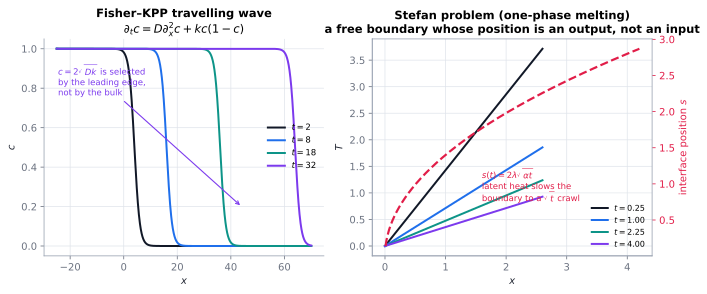

# Phase change & the Stefan problem

> **One-line picture.** A phase boundary is a surface whose *position* is an unknown of the problem,
> and whose motion is paid for in latent heat.
>
> **Prerequisites.** [conduction](../03-microscopic/03-conduction.md) · **Leads to.**
> [free boundaries & phase field](../06-beyond/09-free-boundaries-level-sets-and-phase-field.md)

## L1 · The energy budget of a moving interface

Heat ice and it does not warm monotonically: it sits at $0^\circ$C while melting, because the energy
is spent breaking bonds. In continuum terms the interface advances only as fast as latent heat can be
conducted away:

$$\rho L\dot s=\llbracket k\partial_nT\rrbracket \quad\text{(Stefan condition)},$$

with $L$ the latent heat. This is a **free-boundary problem**: $s(t)$ is part of the solution.

## L2 · The classical solution and its scaling

For one-phase melting from a wall held at a fixed temperature there is a similarity solution,

$$s(t)=2\lambda\sqrt{\alpha t},\qquad\text{with }\lambda\text{ fixed by }
\mathrm{St}\,\lambda e^{\lambda^2}\mathrm{erf}(\lambda)=\text{const},\ \ \mathrm{St}=c_p\Delta T/L .$$

The $\sqrt{t}$ law is the same diffusion scaling as everywhere else, with a prefactor that latent heat
*reduces* — which is why melting ice is so stubbornly slow.

| Situation | Distinctive physics |
|---|---|
| one-phase melting | similarity solution, $s\propto\sqrt{t}$ |
| two-phase Stefan | heat flows in both phases; two jump conditions |
| alloy solidification | mushy zone: solid fraction varies across a temperature interval |
| evaporation / condensation | interfacial resistance plus vapour diffusion; boiling adds nucleation |
| curved interfaces | Gibbs–Thomson: $T_{\rm int}=T_m-\Gamma\kappa$ gives cells and dendrites |
| ablation | the receding surface is the design goal (heat shields, laser machining) |

**Gibbs–Thomson** is why snowflakes have structure: curvature depresses the local melting
temperature, so tips grow faster and side-branches melt back. That is the Mullins–Sekerka
instability — a free-boundary instability driven purely by diffusion.

## L3 · What the mathematics guarantees

* **Well-posedness via the enthalpy formulation.** Writing $\partial_tH=\nabla\cdot(k\nabla T)$ with
  $H(T)$ monotone gives weak solutions, existence and uniqueness; the interface is recovered
  afterwards.
* **Planar fronts are unstable at long wavelengths,** with a selected pattern wavelength set by the
  balance between diffusion and surface tension — the same logic as
  [Turing patterns](04-reaction-diffusion-and-turing.md).
* **History matters.** Fast cooling gives metastable phases, segregation and residual stress: the
  microstructure depends on the whole thermal path, not the final state
  ([accretion & surface growth](11-accretion-ablation-and-surface-growth.md)).
* **Interface kinetics can dominate** at nanoscales: attach rates, not heat flow, set the speed.

## L4 · Numerics

* **Three families of methods**: front tracking (accurate, fails on topology change), enthalpy/fixed
  domain (handles topology, smears the interface), level set / phase field (both, at the cost of a
  thin-interface model) — [free boundaries](../06-beyond/09-free-boundaries-level-sets-and-phase-field.md).
* **Resolution.** One cell of interfacial smear yields $O(\Delta x)$ interface-temperature error;
  phase-field widths must be tied to the grid.
* **Iteration per step** for temperature-dependent properties and latent-heat release; Newton with a
  consistent Jacobian converges in a few iterations.
* **Benchmarks**: the Stefan similarity solution, the gallium melting benchmark, dendritic tip
  velocities ([V&V](../07-numerics/12-verification-validation-and-benchmarks.md)).
* **Frontiers.** Phase change in porous media with flow; additive-manufacturing melt pools; permafrost
  thaw and sea ice ([geoscience & climate](../08-bridges/04-geoscience-and-climate.md)).

## Checks

1. Why does the interface move as $\sqrt{t}$? *(Diffusion-controlled: heat must pass through a
   growing layer.)*
2. What does Gibbs–Thomson add to the Stefan condition? *(A curvature-dependent melting temperature,
   hence interface instability and microstructure.)*
3. What is the price of the enthalpy method? *(No tracking, but a smeared interface and reduced
   interface accuracy.)*

## See also

[Conduction](../03-microscopic/03-conduction.md) ·
[Free boundaries, level sets & phase field](../06-beyond/09-free-boundaries-level-sets-and-phase-field.md) ·
[Fronts & travelling waves](05-fronts-and-travelling-waves.md) ·
[Engineering devices](../08-bridges/06-engineering-devices.md)
