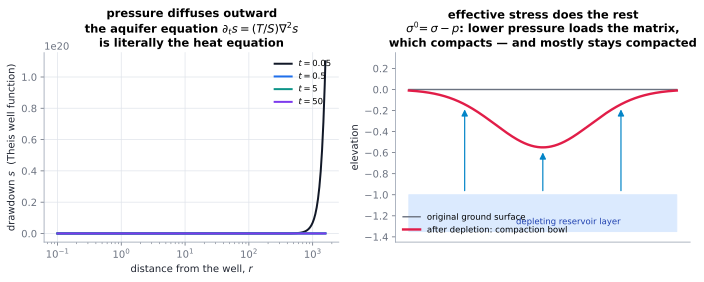

# Subsidence & poroelasticity

> **One-line picture.** Fluids in pores carry part of the load. Take them out and the solid must carry
> more — so it compacts, and the surface above sinks, usually permanently.
>
> **Prerequisites.** [porous media & Darcy](../02-bulk/08-porous-media-and-darcy.md),
> [wells](12-wells-injection-efflux-and-breakthrough.md) · **Leads to.**
> [geoscience & climate](../08-bridges/04-geoscience-and-climate.md),
> [homogenisation](../06-beyond/08-homogenization-and-upscaling.md)

## L1 · Effective stress in one line

Terzaghi's principle: the deformation of a saturated porous solid responds to the **effective stress**

$$\sigma'=\sigma-p .$$

Pump the pore pressure down and the effective stress rises, even though the total load did not
change. The matrix compresses, porosity and permeability drop, and the ground surface subsides —
by centimetres to metres in Mexico City, Venice, and the Central Valley of California. The coupling is
two-way: compaction changes $K$ and $\theta$, which changes the flow
([Darcy](../02-bulk/08-porous-media-and-darcy.md)), which changes the pressure.

## L2 · The equations (Biot) and the simpler limit

Biot's theory couples momentum balance of the solid skeleton with Darcy flow of the fluid:

$$\nabla\cdot\boldsymbol\sigma'-\nabla p=\mathbf{0},\qquad
\partial_t\!\left(\frac{p}{M}+\alpha\nabla\cdot\mathbf{u}\right)=\nabla\cdot\frac{K}{\mu}\nabla p,$$

with $\alpha$ the Biot coefficient and $M$ the Biot modulus. The standard simplification
(one-dimensional consolidation, Terzaghi) yields ever-familiar mathematics:

$$\frac{\partial p}{\partial t}=c_v\frac{\partial^2p}{\partial z^2},\qquad
c_v\sim O\!\left(\frac{K({\rm bulk\ modulus})}{\mu}\right),$$

a diffusion equation again — this time for pressure, with a *rate* of subsidence set by how fast
pressure diffuses through a low-permeability layer (clay: years to decades).

## L3 · What the mathematics guarantees

* **Two time scales.** An instantaneous, elastic (reversible) response plus a slow, draining
  (partly irreversible) response: this is the classic dual behaviour seen in field data, and the
  reason subsidence continues long after pumping stops.
* **Irreversibility is a constitutive property.** Elastic poroelasticity is reversible; real
  reservoirs compact plastically (grain rearrangement, pore collapse). Repressurising recovers only
  part of the deformation — the aquifer "remembers" that it was squeezed.
* **The Mandel–Cryer effect** demonstrates the coupling: pore pressure *rises* temporarily in the
  middle of a loaded sample even while it drains at the boundaries. Any purely decoupled model gets
  this wrong, which is why it is a standard verification test.
* **Stability of coupling.** Monolithic coupling with a proper preconditioner is needed;
  staggered schemes can become unstable when the medium is nearly incompressible
  ([coupling](../07-numerics/05-operator-splitting-and-multiphysics-coupling.md)).
* **Surface footprint.** The subsidence bowl is smoother and wider than the drawdown cone because
  elastic deformation integrates over the whole deforming volume — a Green-function statement
  ([spectral view](../01-foundations/06-spectral-and-green-function-view.md)).

## L4 · Numerics and measurement

* **Coupling strategy**: fully implicit (robust, expensive) versus fixed-stress or undrained splits
  (accurate and stable for moderate coupling); the fixed-stress split is the industry standard.
* **Mesh and geometry**: compaction of thin, soft layers controls surface movement; resolving those
  layers (or using an equivalent lumped model) is essential — see
  [adaptive meshes](../07-numerics/08-mesh-adaptivity-moving-domains-and-parallel.md).
* **Measurement**: levelling surveys, GNSS, InSAR (satellite radar interferometry) for the surface;
  extensometers in wells for in-situ compaction; pressure transducers for drawdown.
* **Benchmarks**: the Mandel problem, Terzaghi consolidation curves, and the Barry–Mercer
  injection test ([V&V](../07-numerics/12-verification-validation-and-benchmarks.md)).
* **Frontiers.** Induced seismicity from pore-pressure changes; CO₂ storage with geomechanical
  feedback; geothermal production; coupling with a changing water table (sea-level rise and
  aquitard drainage).

## Checks

1. Why does the effective stress rise when you pump? *($\sigma'=\sigma-p$ with the total load
   unchanged.)*
2. Why does subsidence lag pumping by years? *(Pressure must diffuse through low-permeability
   layers: $c_v=L^2/t$.)*
3. What does the Mandel–Cryer effect demonstrate? *(That the coupling is genuinely two-way: pressure
   can rise in the interior while the sample drains.)*

## See also

[Wells, injection & breakthrough](12-wells-injection-efflux-and-breakthrough.md) ·
[Porous media & Darcy](../02-bulk/08-porous-media-and-darcy.md) ·
[Multiphysics coupling](../07-numerics/05-operator-splitting-and-multiphysics-coupling.md) ·
[Geoscience & climate](../08-bridges/04-geoscience-and-climate.md)
