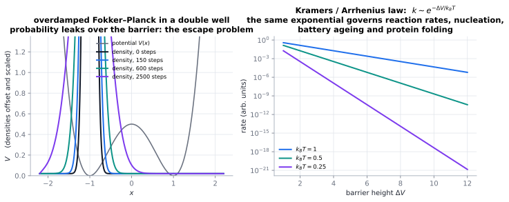

# Fokker–Planck & Kramers escape

> **One-line picture.** If a particle diffuses and is also pushed, its *probability density* obeys a
> transport equation with drift and diffusion. Equilibrium is Boltzmann; escape over a barrier is
> exponential in the barrier height.
>
> **Prerequisites.** [random walks & Langevin](../01-foundations/08-random-walks-langevin-response.md) ·
> **Leads to.** [stochastic PDEs](../06-beyond/07-stochastic-pdes-and-random-media.md),
> [optimal transport & gradient flows](../06-beyond/10-optimal-transport-and-gradient-flows.md)

## L1 · From trajectories to densities

A Langevin particle in a potential $V$ obeys $\gamma\dot x=-V'(x)+\xi(t)$. Its probability density
obeys the **Fokker–Planck equation** (Kolmogorov forward equation)

$$\partial_tp=\partial_x\!\left(\frac{V'(x)}{\gamma}p\right)+D\,\partial_x^2p
=\partial_x\!\left[\frac{1}{\gamma}\left(V'p+k_BT\,\partial_xp\right)\right],$$

and the bracket makes the physics obvious: the drift and the diffusion are locked together at
equilibrium, and the steady state is $p_{\rm eq}\propto e^{-V/k_BT}$ — **detailed balance**, the
probabilistic statement of the [fluctuation–dissipation theorem](../01-foundations/08-random-walks-langevin-response.md).

Note the shape: this is a conservation law with a flux (current) — the same structure as every other
transport equation in this atlas, with "density of substance" replaced by "density of probability".

## L2 · Kramers' escape problem

Put the particle in a metastable well of depth $\Delta V$ separated by a barrier. Naively it needs
energy $\Delta V$ to escape, and the Arrhenius/Kramers law says the rate is

$$k_{\rm esc}\sim A\,e^{-\Delta V/k_BT},$$

with a prefactor $A$ that itself depends on friction (the **Kramers turnover**: too little friction and
the particle cannot gain energy, too much and it cannot cross — escape is *slowest* at an
intermediate friction, a genuinely counter-intuitive result).

| Limit | Behaviour | Setting |
|---|---|---|
| zero temperature | no escape | classical freezing |
| moderate friction | Kramers turnover | reactions in solution |
| low friction | energy diffusion limited | gas-phase reactions |
| high friction | spatial diffusion limited | reactions in viscous media |
| quantum | tunnelling below the barrier | isotope effects, catalysis |

## L3 · What the mathematics guarantees

* **The generator/adjoint pairing.** Fokker–Planck is the forward equation while its adjoint
  (backward Kolmogorov) governs expectation values and first-passage times. Solving the backward
  equation gives mean-first-passage times directly — the cleanest route to Kramers' formula.
* **Entropy increases.** The relative entropy $\int p\ln(p/p_{\rm eq})$ decreases monotonically
  (H-theorem again), which is why Fokker–Planck is a
  [gradient flow in the Wasserstein metric](../06-beyond/10-optimal-transport-and-gradient-flows.md)
  — the JKO structure — with both exponential and polynomial relaxation depending on the potential.
* **Eigenvalue problem and spectral gap.** For convex $V$ the spectrum is discrete and the relaxation
  is exponential with rate set by the smallest nonzero eigenvalue; for double wells the gap is
  exponentially small, which is exactly why barrier crossing is rare and hard to sample.
* **Metastability and mean first passage.** The exponentially small gap implies an exponentially long
  time to explore all states: the practical definition of a metastable system, and the reason
  coarse-graining in time is unavoidable ([memory & linear response](../01-foundations/09-linear-response-and-memory.md)).

## L4 · Numerics

* **Direct solvers** for Fokker–Planck in low dimensions: spectral methods in space, implicit time
  stepping, conservative formulations. They beat particle methods when $d\le3$.
* **Monte Carlo** (Langevin/Brownian dynamics) for high dimensions: error $N^{-1/2}$ but no meshing,
  and it can get stuck — barrier crossing is rarely observed directly.
* **Rare-event methods**: importance sampling, umbrella sampling, forward flux sampling, transition
  path sampling; all exploit the fact that the *rate*, not the trajectory, is what you need.
* **Consistency checks**: Boltzmann equilibrium recovery, detailed balance in the discrete scheme, and
  zero-current conditions as $t\to\infty$
  ([verification](../07-numerics/12-verification-validation-and-benchmarks.md)).
* **Frontiers.** Kramers theory with non-Markovian memory, non-equilibrium driving, and applications to
  protein folding, nucleation, and battery ageing
  ([biology & medicine](../08-bridges/03-biology-and-medicine.md)).

## Checks

1. Why is the equilibrium distribution Boltzmann? *(Drift and diffusion are locked by the FDT, so the
   zero-current condition forces the Gibbs form.)*
2. Why is escape slowest at intermediate friction? *(Energy and spatial diffusion must both succeed —
   the Kramers turnover.)*
3. Why is direct simulation bad at measuring escape rates? *(The waiting time is exponential in the
   barrier; you may never see an event.)*

## See also

[Random walks, Langevin & response](../01-foundations/08-random-walks-langevin-response.md) ·
[Optimal transport & gradient flows](../06-beyond/10-optimal-transport-and-gradient-flows.md) ·
[Stochastic PDEs & random media](../06-beyond/07-stochastic-pdes-and-random-media.md) ·
[The Boltzmann equation](01-boltzmann-equation.md)
