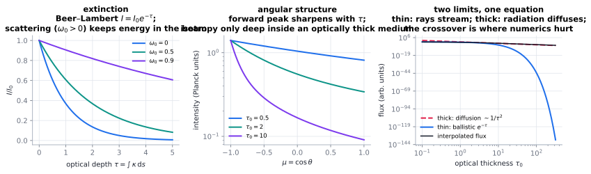

# Radiative transfer & neutron transport

> **One-line picture.** Radiation travels in straight lines until it is absorbed or scattered, so its
> transport equation is *directional* — and the scattering term makes it non-local in angle.
>
> **Prerequisites.** [conduction](../03-microscopic/03-conduction.md) · **Leads to.**
> [plasma & astrophysics](../08-bridges/05-plasma-and-astrophysics.md),
> [engineering devices](../08-bridges/06-engineering-devices.md)

## L1 · The equation and its meaning

Intensity $I(\mathbf{x},\boldsymbol\Omega,\nu,t)$ obeys the **radiative transfer equation** (RTE):

$$\frac1c\partial_tI+\boldsymbol\Omega\cdot\nabla I
=-\kappa_aI-\sigma_sI+j_\nu
+\sigma_s\!\int_{4\pi}I(\boldsymbol\Omega')\Phi\,d\Omega' ,$$

i.e. absorption, out-scattering, emission, in-scattering. The directional derivative is first order,
but the in-scattering integral makes the equation **integro-differential**: light arriving here may
have come from anywhere, including places whose radiation depends on here. Non-locality is the
defining feature, and it is why radiation cannot be handled by a bigger conductivity except in limits.

The **neutron transport equation** has the same structure with capture, scattering and a fission
multiplication term — the basis of reactor criticality, shielding and dosimetry.

## L2 · The two limits and the parameters that interpolate

| Regime | Criterion | Approximation |
|---|---|---|
| optically thin | $\tau=\int\kappa\,ds\ll1$ | Beer–Lambert $I=I_0e^{-\tau}$; rays decouple |
| optically thick | $\tau\gg1$ | **Rosseland diffusion** $\mathbf q=-\frac{4\pi}{3\kappa}\nabla B$: radiation becomes conduction |
| scattering-dominated | albedo $\omega_0\to1$ | diffusive even when thin: long photon paths |
| strongly forward-scattering | asymmetry $g\to1$ | delta-Eddington, similarity transformations |
| neutron, multiplying | $k_{\rm eff}=1$ | criticality: an eigenvalue problem |

| Method | Idea | Cost |
|---|---|---|
| discrete ordinates ($S_N$) | discretise directions, sweep | cheap; ray effects on coarse angular grids |
| Monte Carlo | sample photon/neutron histories | exact geometry, flexible; noisy ($N^{-1/2}$) |
| moment methods (P1, P3) | spherical harmonics expansion | fast, poor at boundaries and when thin |
| diffusion / flux-limited diffusion | asymptotic thick limit | standard in astrophysics and cores |
| ray tracing / characteristics | integrate along rays | excellent for beams and lasers |

## L3 · What the mathematics guarantees

* **Interfaces jump, and the opaque limit is a surface problem**: emissivity/reflectivity conditions
  give the classical view-factor and radiosity networks of thermal engineering.
* **The diffusion limit is a theorem — and a warning.** A scheme accurate at $\tau\sim1$ need not
  converge to the diffusion limit as $\tau\to\infty$: **asymptotic-preserving** schemes are required,
  and their absence lets energy leak through thick shields.
* **Neutron criticality is a non-self-adjoint eigenvalue problem** for $k_{\rm eff}$; multiplication
  breaks symmetry, so specialised solvers are needed.
* **Kirchhoff's law** (emissivity $=$ absorptivity) is detailed balance — the radiative face of the
  [fluctuation–dissipation theorem](../01-foundations/08-random-walks-langevin-response.md).

## L4 · Numerics

* **Angular discretisation is the hard part**: ray effects are the classic $S_N$ artifact; remedies
  include richer quadrature, rotated quadratures, and Monte Carlo hybrids.
* **Asymptotic preservation** is the design criterion: accurate in thin media *and* in the diffusion
  limit without resolving either.
* **Radiation hydrodynamics is stiff** (opacity ↔ temperature ↔ field): implicit coupled solves are
  standard ([splitting & coupling](../07-numerics/05-operator-splitting-and-multiphysics-coupling.md)).
* **Benchmarks**: the Marshak wave, plane-parallel albedo, and standard neutron benchmarks (Godiva,
  C5G7) ([V&V](../07-numerics/12-verification-validation-and-benchmarks.md)).
* **Frontiers.** Exoplanet and fusion-plasma radiation; multigroup opacity tables; hybrid
  Monte Carlo–deterministic solvers; radiative transfer in turbulence.

## Checks

1. What single feature distinguishes the RTE from every other equation here? *(Angular non-locality
   through in-scattering.)*
2. When may radiation be treated as conduction? *(Optically thick — the Rosseland limit.)*
3. Why do naive schemes fail in thick media? *(They do not preserve the diffusion limit.)*

## See also

[Conduction](../03-microscopic/03-conduction.md) ·
[The Boltzmann equation](01-boltzmann-equation.md) ·
[Plasma & astrophysics](../08-bridges/05-plasma-and-astrophysics.md) ·
[Absorption & interfacial transfer](../04-interaction/08-absorption-dissolution-and-interfacial-transfer.md)
