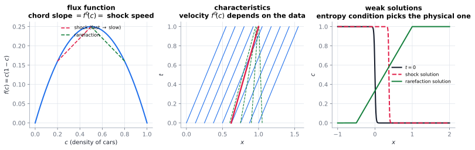

# Conservation laws & shocks

> **One-line picture.** When the speed of transport depends on how much is being transported, waves can
> catch each other up. When they do, the solution jumps — and the equation must be reinterpreted.
>
> **Prerequisites.** [advection](../02-bulk/01-advection.md),
> [PDE taxonomy](../01-foundations/04-pde-taxonomy-and-boundary-conditions.md) · **Leads to.**
> [Hamilton–Jacobi & viscosity solutions](02-hamilton-jacobi-and-viscosity-solutions.md),
> [limiters, TVD & WENO](../07-numerics/04-limiters-tvd-and-weno.md)

## L1 · Why a shock is not a pathology

For $\partial_tc+\partial_xf(c)=0$ with nonlinear $f$ (Burgers' $f=\frac12c^2$, traffic $f=c(1-c)$),
the solution is constant along characteristics $\dot x=f'(c)$. A *faster* characteristic behind a
*slower* one will overtake it, and two values want to exist at the same place. That is a shock — not an
error, but the traffic jam you have experienced.

Real examples: gas dynamics, traffic (Lighthill–Whitham–Richards), two-phase flow in porous media
(Buckley–Leverett, the basis of oil-recovery models), chromatography, sedimentation (Kynch), flood
waves, and reactive transport with nonlinear isotherms.

## L2 · Weak solutions and the two conditions

Beyond the breaking time the classical solution fails, so reinterpret the PDE as the *integral*
balance law, which permits jumps. A mass balance on a shrinking control volume gives the
**Rankine–Hugoniot** condition (the chord slope is the shock speed):

$$s=\frac{f(c_R)-f(c_L)}{c_R-c_L}.$$

But the integral form admits several weak solutions (including non-physical expansion shocks). The
physical one is chosen by an **entropy condition**: Lax's $f'(c_L)>s>f'(c_R)$, or a vanishing-viscosity
regularisation $c_t+f(c)_x=\varepsilon c_{xx}$ as $\varepsilon\to0$, or a convex entropy inequality
$\partial_t\eta+\partial_xq\le0$. **Microscopic viscosity — the effect we threw away — is what selects
the answer.**

| Structure | Condition | Shape |
|---|---|---|
| shock | characteristics converge | jump satisfying entropy condition |
| rarefaction | characteristics diverge | smooth fan |
| contact | equal speeds across | jump in a passive quantity |
| non-convex flux | chord / equal-area rule | mixes rarefactions and shocks |

## L3 · What the mathematics guarantees

* **Uniqueness needs the entropy condition.** Without it weak solutions are non-unique: a
  well-posed-looking PDE is ill-posed until the selection principle is added.
* **Regularisations agree.** Vanishing viscosity, relaxation and kinetic limits all pick the same
  entropy solution under mild conditions — several unrelated derivations reach one answer.
* **Systems are richer.** For Euler, shallow water or MHD, genuinely nonlinear and linearly degenerate
  families behave differently, and non-classical (undercompressive) shocks appear in special regimes.
* **Long-time behaviour self-organises into $N$-waves**: for scalar laws the large-time solution is
  fixed by the area under the initial data, not its shape. Shocks are the attractors of nonlinear
  transport.

## L4 · Numerics

* **Flux (conservative) form is mandatory**; otherwise the telescoping integral balance is lost and the
  shock speed is wrong.
* **Monotone first-order schemes converge to the entropy solution**; high-order schemes need
  [TVD/ENO/WENO limiters](../07-numerics/04-limiters-tvd-and-weno.md), because Godunov's theorem
  forbids linear monotone schemes above first order.
* **Riemann solvers** (Roe, HLLC, AUSM) work face-by-face; approximate solvers need entropy fixes to
  avoid expansion shocks.
* **Benchmarks**: Sod and Lax shock tubes, Buckley–Leverett, LWR with a bottleneck, dam break
  ([V&V](../07-numerics/12-verification-validation-and-benchmarks.md)).
* **Frontiers.** UQ for hyperbolic systems; shocks in random media
  ([stochastic PDEs](07-stochastic-pdes-and-random-media.md)); learned limiters; compositional flow.

## Checks

1. Shock speed for Burgers with $c_L=1$, $c_R=-1$? *( $s=\frac12(-1-1)/(-2)=1$: moves right.)*
2. Why is an entropy condition needed at all? *(Weak solutions are non-unique; it rules out expansion
   shocks.)*
3. Why does a non-conservative scheme get the shock speed wrong? *(It violates the discrete integral
   balance, hence Rankine–Hugoniot.)*

## See also

[Hamilton–Jacobi & viscosity solutions](02-hamilton-jacobi-and-viscosity-solutions.md) ·
[Limiters, TVD & WENO](../07-numerics/04-limiters-tvd-and-weno.md) ·
[Nonlinear diffusion & porous medium](06-nonlinear-diffusion-and-porous-medium.md) ·
[Networks, society & traffic](../08-bridges/09-networks-society-and-traffic.md)
