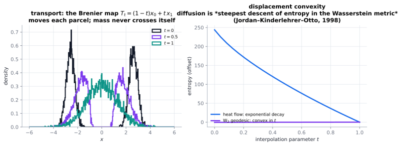

# Optimal transport & gradient flows

> **One-line picture.** Ask "what is the cheapest way to move one density into another?" and you get a
> *distance* between distributions. In that distance, diffusion is simply rolling downhill.
>
> **Prerequisites.** [entropy & variational structure](../01-foundations/07-entropy-and-variational-structure.md) ·
> **Leads to.** [one mathematics of transport](../08-bridges/11-unifying-mathematics-of-transport.md),
> [machine learning & data](../08-bridges/07-machine-learning-and-data.md)

## L1 · The distance, and the map

The **Wasserstein distance** $W_2(\rho_0,\rho_1)$ is the square root of the minimal cost of moving mass
with cost $=$ distance². In 1-D the optimal map is explicit — sort the quantiles and match them
(monotone rearrangement). In higher dimensions it is the gradient of a convex function (Brenier).

Two facts make this much more than a curiosity:

* **Transport is a continuity equation**: any motion of mass obeys
  $\partial_t\rho+\nabla\cdot(\rho\mathbf v)=0$, and $W_2$ measures the cheapest such velocity field.
  Benamou–Brenier turned this into a fluid-dynamical formulation of optimal transport.
* **Diffusion is the steepest descent of entropy in $W_2$.** Heat flow, Fokker–Planck, the porous-medium
  equation and aggregation–diffusion models are all $W_2$ gradient flows — unifying transport phenomena,
  nonlinear PDEs and optimisation.

## L2 · The JKO scheme

Time-discretise the flow by minimising

$$\rho^{n+1}=\arg\min_\rho\left[\frac{1}{2\tau}W_2^2(\rho,\rho^n)+F(\rho)\right],$$

the **Jordan–Kinderlehrer–Otto** scheme: one implicit step of *any* $W_2$ gradient flow. Variational, so
it inherits existence, uniqueness and stability — and it is a practical method ("minimise, don't march").

| Functional $F$ | Gradient flow | Physics |
|---|---|---|
| entropy $\int\rho\ln\rho$ | heat, Fokker–Planck | diffusion, sampling |
| internal energy $\frac{1}{m-1}\int\rho^m$ | porous medium | degenerate diffusion, fronts |
| interaction $+$ entropy | aggregation–diffusion | chemotaxis, swarming |
| potential $+$ entropy | Fokker–Planck with $V$ | barrier crossing |

## L3 · What the mathematics guarantees

* **Displacement convexity.** If $F$ is convex along Wasserstein geodesics, the flow contracts in $W_2$
  and JKO converges; quantitative constants give explicit decay rates. The strongest general tool for
  nonlinear diffusion.
* **Contraction is stability.** Metric contraction is exactly what makes a scheme stable, which is why
  JKO-type methods are unconditionally stable and monotone in energy.
* **The metric encodes the physics:** $W_2\to$ diffusion, $L^2\to$ Allen–Cahn, $H^{-1}\to$ Cahn–Hilliard.
  There is no "correct" metric in the abstract, only the physics.
* **Connections**: Otto calculus (Riemannian structure on densities), Schrödinger bridges
  (entropy-regularised transport — the basis of modern generative sampling), and optimal transport in
  economics and machine learning.

## L4 · Numerics

* **1-D is easy**: monotone rearrangement gives exact geodesics — an excellent diagnostic and a building
  block in higher dimensions.
* **Implicit gradient-flow schemes** (backward Euler, convex splitting, JKO) are stable at large steps and
  energy-monotone; explicit schemes usually are not.
* **Entropic regularisation (Sinkhorn)** turns transport into soft matrix scaling — why OT is now standard
  in machine learning ([ML & data](../08-bridges/07-machine-learning-and-data.md)).
* **Benchmarks**: heat-flow decay versus JKO minimisation, Barenblatt profiles from JKO steps, Sinkhorn
  against exact 1-D transport ([V&V](../07-numerics/12-verification-validation-and-benchmarks.md)).
* **Frontiers.** Transport-based UQ; flow matching and score-based generative models; OT on graphs;
  non-convex and non-smooth gradient flows.

## Checks

1. Why is diffusion a "transport"? *($\partial_t\rho+\nabla\cdot(\rho\mathbf v)=0$ with
   $\mathbf v=-\nabla\ln\rho$.)*
2. What is JKO in one sentence? *(Implicit minimisation of free energy plus a Wasserstein penalty.)*
3. Why does the metric change the equation? *(Each metric defines a different steepest descent.)*

## See also

[Entropy & variational structure](../01-foundations/07-entropy-and-variational-structure.md) ·
[Nonlinear diffusion & porous medium](06-nonlinear-diffusion-and-porous-medium.md) ·
[Machine learning & data](../08-bridges/07-machine-learning-and-data.md) ·
[One mathematics of transport](../08-bridges/11-unifying-mathematics-of-transport.md)
