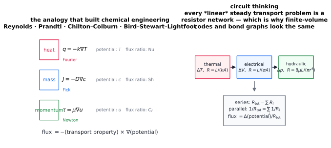

# Heat–mass–momentum analogy & circuit models

> **One-line picture.** Fourier, Fick and Newton are the same equation with different words. Once you
> see that, every linear steady transport problem becomes a resistor network.
>
> **Prerequisites.** [constitutive relations](../01-foundations/03-constitutive-relations.md),
> [boundary layers](../02-bulk/04-boundary-layers.md)

## L1 · The analogy

$$\text{flux}=-\text{(property)}\times\nabla\text{(potential)}$$

| Transport | Flux | Potential | Property | Dimensionless flux |
|---|---|---|---|---|
| heat | $\mathbf q$ | $T$ | $k$, $\alpha$ | $\mathrm{Nu}$ |
| mass | $\mathbf J$ | $c$ | $D$ | $\mathrm{Sh}$ |
| momentum | $\boldsymbol\tau$ | $u$ | $\mu$, $\nu$ | $C_f$ |

The analogy becomes quantitative through **Chilton–Colburn**: for the same geometry and flow, the
dimensionless transfer coefficients are equal up to a weak power of the ratio of diffusivities:

$$j_H=\frac{\mathrm{Nu}}{\mathrm{Re}\,\mathrm{Pr}^{1/3}}\approx j_D=\frac{\mathrm{Sh}}{\mathrm{Re}\,\mathrm{Sc}^{1/3}}\approx \frac{C_f}{2},$$

valid when $\mathrm{Pr}$, $\mathrm{Sc}\sim O(1)$ and there is no form drag or blowing. Consequences:
measure one coefficient, predict the other two; calibrate a heat-transfer experiment and use it for a
drying or dissolution problem.

Where the analogy fails is as instructive as where it works: separated flow and form drag (momentum
transfer is dominated by pressure, not skin friction), transpiration/blowing (mass transfer at the wall
modifies the boundary layer), and very large $\mathrm{Pr}$ or $\mathrm{Sc}$ (different layer thicknesses).

## L2 · Resistance networks and bond graphs

Steady linear transport is circuit analysis:

| Domain | "Ohm's law" | Resistance |
|---|---|---|
| thermal | $q=\Delta T/R$ | $L/(kA)$; interface $1/(hA)$ |
| electrical | $I=\Delta V/R$ | $L/(\sigma A)$ |
| hydraulic | $Q=\Delta p/R$ | $8\mu L/(\pi r^4)$ (Hagen–Poiseuille) |
| diffusive mass | $\dot m=\Delta c/R$ | $L/(DA)$ |

Series adds resistances, parallel adds conductances, and transient problems gain capacitances
($C=\rho c_pV$ for thermal, $\theta V$ for sorptive mass storage), giving first-order time constants
$\tau=RC$. This is why chemical engineers draw networks rather than solve PDEs, and why
finite-volume codes and bond graphs look structurally identical.

## L3 · Consequences worth remembering

* **The bottleneck wins**: total resistance is dominated by the largest element — usually the
  interfacial film or contact resistance, not the bulk. That is why one clean surface beats a better
  material.
* **Dimensionless transfer coefficients are transferable**: the same correlation works for a heated pipe,
  an electrode and a dissolving tablet when the geometry is similar.
* **The analogy gives order-of-magnitude estimates in minutes**, which is what you need before choosing
  a mesh.

## L4 · Numerics

* **Wall functions and correlations are the lumped models** of the network view; replacing them with
  resolved simulation is expensive and sometimes unnecessary.
* **Verification by analogy**: if your 2-D conjugate heat-transfer solver gives a $\mathrm{Nu}$ far from
  the correlation for the same $\mathrm{Re}$ and $\mathrm{Pr}$, suspect the boundary layer resolution or
  an interface error.

## Checks

1. Why is $j_H\approx j_D$ useful, and when does it fail? *(It lets one measurement predict both heat and
   mass transfer; it fails with form drag, surface blowing and extreme $\mathrm{Pr}/\mathrm{Sc}$.)*
2. Which resistance usually dominates in a heat exchanger? *(The films, not the wall — unless fouling
   adds more.)*

## See also

[Boundary layers](../02-bulk/04-boundary-layers.md) ·
[Conduction](../03-microscopic/03-conduction.md) ·
[Engineering devices](06-engineering-devices.md) ·
[Constitutive relations](../01-foundations/03-constitutive-relations.md)
