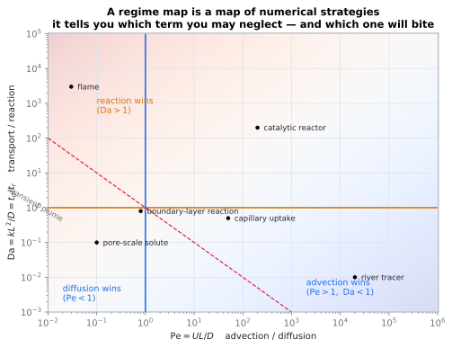

# Dimensionless number cards

> Each card: **definition → what it compares → what happens at the extremes → where to read more.**
> Definitions vary between communities (especially $\mathrm{Da}$ and $\mathrm{Bi}$); always state yours.

## Transport ratios

**Péclet** $\mathrm{Pe}=UL/D$ — advection vs diffusion. $\ll1$: diffusion wins, smooth fields; $\gg1$: sharp
fronts, boundary layers. Groundwater ${>}10^{4}$, cells ${<}10^{-2}$.
→ [dimensionless numbers](../01-foundations/05-dimensionless-numbers.md)

**Reynolds** $\mathrm{Re}=UL/\nu$ — inertia vs viscosity. ${<}1$: creeping, reversible; $10^{3}$–$10^{5}$:
turbulent transition; ${>}10^{6}$: fully turbulent. Microbe ${<}1$, river $10^{6}$, climate $10^{9}$.
→ [turbulence](../02-bulk/05-turbulence-and-eddy-diffusivity.md)

**Rayleigh** $\mathrm{Ra}=g\beta\Delta TL^3/(\nu\alpha)$ — buoyancy vs dissipation. ${<}1708$: conduction
only; $10^{3}$–$10^{6}$: steady rolls; $10^{8}$–$10^{10}$: turbulence ($\mathrm{Nu}\sim\mathrm{Ra}^{0.3}$);
mantle $\sim10^{8}$, Sun $\sim10^{22}$.
→ [convection](../02-bulk/02-convection-and-buoyancy.md)

**Damköhler** $\mathrm{Da}=kL^2/D$ (diffusion-based) or $kL/U$ (advection-based) — transport vs reaction.
$\ll1$: transport-limited, chemistry space-filling; $\gg1$: reaction-limited, thin sheets.
→ [reaction kinetics](../04-interaction/01-reaction-kinetics-and-sinks.md)

**Knudsen** $\mathrm{Kn}=\lambda/L$ — mean free path vs device. ${<}0.01$: continuum; $0.01$–$0.1$: slip;
$0.1$–$10$: transition; ${>}10$: free molecular.
→ [Knudsen transport](../03-microscopic/05-knudsen-and-rarefied-transport.md)

**Nusselt** $\mathrm{Nu}=hL/k$ — total heat transfer vs pure conduction. $1$: no advection; $100$:
vigorous convection. Correlated as $\mathrm{Nu}=C\,\mathrm{Re}^m\mathrm{Pr}^n$ in forced flow.
→ [boundary layers](../02-bulk/04-boundary-layers.md)

**Sherwood** $\mathrm{Sh}=h_mL/D$ — mass analogue of $\mathrm{Nu}$; **Chilton–Colburn** links
$j_D\approx j_H\approx C_f/2$.
→ [analogy](../08-bridges/01-analogy-and-circuit-models.md)

**Prandtl / Schmidt / Lewis** $\mathrm{Pr}=\nu/\alpha$, $\mathrm{Sc}=\nu/D$, $\mathrm{Le}=\mathrm{Sc}/\mathrm{Pr}$
— relative thicknesses of momentum, thermal and mass boundary layers. Gases: $\mathrm{Pr}\approx0.7$,
$\mathrm{Sc}\approx1$; water: $\mathrm{Pr}\approx7$, $\mathrm{Sc}\approx1000$ (liquid), $\mathrm{Sc}\approx600$
for salt.
→ [boundary layers](../02-bulk/04-boundary-layers.md)

## Interface and device numbers

**Biot** $\mathrm{Bi}=hL/k_{\rm solid}$ — external vs internal resistance. ${<}0.1$: lumped capacitance
valid; ${>}10$: strong internal gradients.
→ [engineering devices](../08-bridges/06-engineering-devices.md)

**Fourier** $\mathrm{Fo}=\alpha t/L^2$ — dimensionless time for conduction (transient processes).
**Stefan** $\mathrm{St}=c_p\Delta T/L_{\rm latent}$ — sensible vs latent heat in phase change; small
$\mathrm{St}$ means latent heat dominates and interfaces crawl as $\sqrt{t}$.
→ [phase change](../04-interaction/09-phase-change-and-stefan.md)

**Brinkman** $\mathrm{Br}=\mu U^2/(k\Delta T)$ and **Eckert** $\mathrm{Ec}=U^2/(c_p\Delta T)$ — viscous
dissipation vs conduction: the number that decides whether high-speed or polymer flow self-heats.
→ [viscous dissipation](../04-interaction/14-viscous-dissipation-and-heating.md)

**Thiele modulus** $\phi=L\sqrt{k/D}$ — reaction vs pore diffusion; effectiveness factor
$\eta=\tanh\phi/\phi$.
→ [engineering devices](../08-bridges/06-engineering-devices.md)

**Grashof / Richardson** $\mathrm{Gr}=g\beta\Delta TL^3/\nu^2$, $\mathrm{Ri}=\mathrm{Gr}/\mathrm{Re}^2$ —
natural vs forced convection: $\mathrm{Ri}\lesssim0.1$ forced, $\gtrsim10$ natural.
**Marangoni** $\mathrm{Ma}=\sigma_T\Delta TL/(\mu\alpha)$ — surface-tension vs viscous forces; dominates in
small systems. → [convection](../02-bulk/02-convection-and-buoyancy.md)

**Mach** $U/c_s$ — compressibility (${>}0.3$ matters, ${>}1$ shocks); **Froude** $U/\sqrt{gL}$ —
gravity waves; **Weber** $\rho U^2L/\sigma$ — inertia vs surface tension (drop breakup);
**Capillary** $\mu U/\sigma$; **Bond** $\Delta\rho gL^2/\sigma$ — gravity vs surface tension.
→ [advection](../02-bulk/01-advection.md), [free boundaries](../06-beyond/09-free-boundaries-level-sets-and-phase-field.md)

**Weissenberg / Deborah** $\mathrm{Wi}=\lambda\dot\gamma$, $\mathrm{De}=\lambda/t_{\rm obs}$ — elastic
memory vs flow time; ${>}1$ elasticity dominates.
→ [non-Newtonian rheology](../02-bulk/09-non-newtonian-rheology.md)

**Stefan number, Jakob, Rayleigh–Darcy** appear in porous-media phase change;
$\mathrm{Ra}_{\rm Darcy}=g\beta\Delta TKL/(\nu\alpha)$ is the porous analogue of $\mathrm{Ra}$.
→ [Darcy flow](../02-bulk/08-porous-media-and-darcy.md)

## More cards: fluid, interface, plasma and quantum

| Number | Definition | Reading |
|---|---|---|
| Hartmann $\mathrm{Ha}$ | $B_0L\sqrt{\sigma/\mu}$ | magnetic braking: $\gg1$ ⟹ Hartmann layers, flattened (quasi-2-D) flow |
| Stuart $\mathrm{N}$ | $\sigma B_0^2L/(\rho U)$ | magnetic vs inertial forces — MHD turbulence suppressor |
| Reynolds magnetic $\mathrm{Rm}$ | $UL/\eta$ | $\gg1$: field frozen in, dynamo action possible; $\ll1$: field diffuses |
| Lundquist $\mathrm{Lu}$ | $B_0L\sqrt{\mu_0\rho}/\eta$ | Alfvénic vs resistive time: reconnection regime |
| Plasma beta $\beta$ | $2\mu_0p/B^2$ | $\ll1$: magnetically dominated (corona); $\gg1$: pressure dominated (core) |
| Hall parameter | $\omega_c\tau$ | magnetisation of carriers — Hall effect, magnetoresistance |
| Womersley $\alpha$ | $R\sqrt{\omega/\nu}$ | pulsatile flow: $\gg1$ ⟹ plug-like with thin Stokes layer (aorta) |
| Strouhal $\mathrm{St}$ | $fL/U$ | vortex shedding frequency; acoustics of jets |
| Bond $\mathrm{Bo}$ | $\Delta\rho gL^2/\sigma$ | gravity vs surface tension: drops, bubbles, capillary length |
| Capillary $\mathrm{Ca}$ | $\mu U/\sigma$ | viscous vs capillary: coating, displacement in porous media |
| Ohnesorge $\mathrm{Oh}$ | $\mu/\sqrt{\rho\sigma L}$ | atomisation regime maps |
| Morton $\mathrm{Mo}$ | $g\mu^4/(\rho\sigma^3)$ | bubble shape regime (with $\mathrm{Eo}$, $\mathrm{Re}$) |
| Jakob $\mathrm{Ja}$ | $\rho c_p\Delta T/(\rho_vh_{fg})$ | boiling/condensation; $\gg1$ ⟹ fast evaporation |
| Rayleigh–Darcy $\mathrm{Ra}_{\rm D}$ | $g\beta\Delta TKL/(\nu\alpha)$ | porous-medium convection threshold (${>}4\pi^2$) |
| Zeldovich $\mathrm{Ze}$ | $E_a\Delta T/(RT^2)$ | combustion sensitivity; $\gg1$ ⟹ thin flame sheets |
| Damköhler II/III | $kC_0L/U$ etc. | competing definitions: state which (heat release vs mixing) |
| Bodenstein $\mathrm{Bo}_{\rm ch}$ | $uL/D_{\rm ax}$ | reactor back-mixing (plug-flow limit $\to\infty$) |
| Thiele $\phi$ | $L\sqrt{k/D}$ | catalyst effectiveness $\eta=\tanh\phi/\phi$ |
| Graetz $\mathrm{Gz}$ | $\mathrm{Re}\,\mathrm{Pr}\,D/L$ | developing thermal profiles in ducts; entrance length |
| Stokes number (aerosol) $\mathrm{Stk}$ | $\tau_pU/L$ | particle inertia: $\gg1$ ⟹ impaction, $\ll1$ ⟹ follows flow |
| Knudsen diffusion ratio | $D_K/D_{\rm mol}$ | which diffusion regime a pore is in |
| Boltzmann number $\mathrm{Bo}_{\rm rad}$ | $\rho c_pU/(\sigma T^3)$ | when radiation matters in a flow |
| Photon optical depth $\tau$ | $\int\kappa\,\mathrm ds$ | thin vs thick radiative transfer |
| Batchelor number | $\nu/D$ in a scalar cascade | scalar dissipation scales |
| Deborah / Weissenberg | $\lambda/t_{\rm obs}$, $\lambda\dot\gamma$ | viscoelasticity onset |
| Péclet (thermal) | $UL/\alpha$ | advection vs conduction (distinct from mass $\mathrm{Pe}$) |
| Nusselt (film) / Biot (fluid) | $hL/k_{\rm solid}$ | which resistance controls: external film or internal conduction |
| Marangoni, Rayleigh, Grashof, Richardson | see above | surface vs buoyancy vs forced convection |
| Reynolds (porous) $\mathrm{Re}_{\rm pore}$ | $\rho qd/\mu$ | Forchheimer onset ($\gtrsim1{-}10$) |
| Magnetic Reynolds, Hall, Lundquist | see above | the MHD triad: dynamo, magnetisation, reconnection |
| Quantum: de Broglie ratio | $\lambda_{\rm dB}/L$ | when quantum transport corrections matter |
| Thermal de Broglie | $\lambda_{\rm dB}/d$ | quantum degeneracy of a gas (BEC threshold) |
| Knudsen (kinetic) | $\lambda/L$ | the master number for leaving the continuum |

> [!tip] How to use these
> Two habits: **(1)** always state which definition you mean when a number has several (Damköhler,
> Biot, Reynolds); **(2)** convert your number into a *ratio of timescales* — that is what makes it
> interpretable, and it is how you spot the regime where your assumption (continuum, mean field, dilute,
> Newtonian) quietly fails.

## See also

[Dimensionless numbers](../01-foundations/05-dimensionless-numbers.md) ·
[Symbol glossary](01-symbol-glossary.md)

